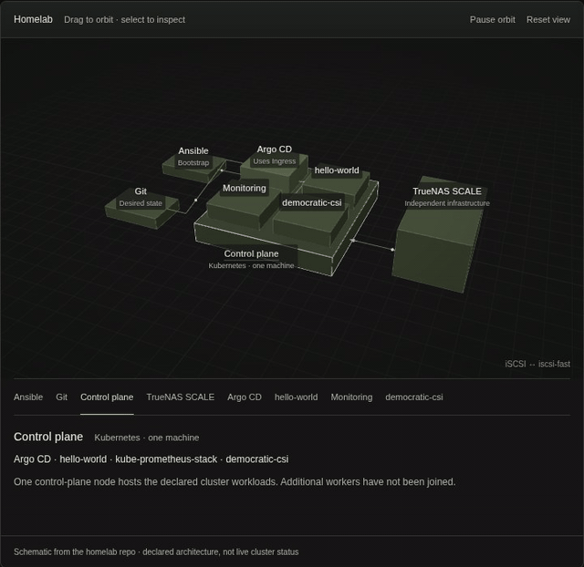
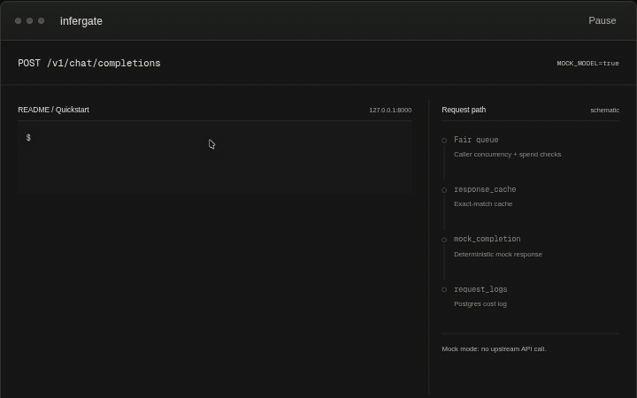
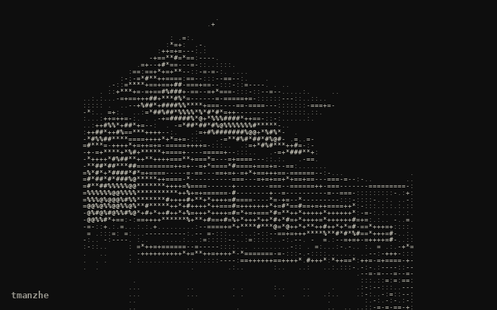

<table width="100%" cellpadding="12" cellspacing="0">
  <tr>
    <td valign="middle">
      <a href="https://github.com/tmanzhe" title="GitHub"><picture><source media="(prefers-color-scheme: dark)" srcset="https://cdn.simpleicons.org/github/e3dfd8"></picture></a>
      <a href="https://www.linkedin.com/in/trumanchan/" title="LinkedIn"><picture><source media="(prefers-color-scheme: dark)" srcset="assets/linkedin-dark.svg"></picture></a>
      <a href="https://www.tmanzhe.com/" title="Portfolio"><picture><source media="(prefers-color-scheme: dark)" srcset="assets/portfolio-dark.svg"></picture></a>
      <b>Hi, I'm Truman.</b>
      
I'm a CS / Management double-degree student at York University and Schulich, based in Toronto. 
      I'll be joining BMO as a Software Engineer Intern in January 2027. 
      I'm interested in backend systems, data, and infrastructure, and I run a homelab.

    </td>
  </tr>
  <tr>
    <td align="center">
      
      
    </td>
  </tr>
  <tr>
    <td align="center">
      
      
    </td>
  </tr>
  <tr>
    <td>
      <b>languages</b> 
      <picture><source media="(prefers-color-scheme: dark)" srcset="https://img.shields.io/badge/Python-131313?style=flat&amp;logo=python&amp;logoColor=e3dfd8"></picture>
      <picture><source media="(prefers-color-scheme: dark)" srcset="https://img.shields.io/badge/TypeScript-131313?style=flat&amp;logo=typescript&amp;logoColor=e3dfd8"></picture>
      <picture><source media="(prefers-color-scheme: dark)" srcset="https://img.shields.io/badge/Go-131313?style=flat&amp;logo=go&amp;logoColor=e3dfd8"></picture>
      <picture><source media="(prefers-color-scheme: dark)" srcset="https://img.shields.io/badge/Swift-131313?style=flat&amp;logo=swift&amp;logoColor=e3dfd8"></picture>
      <picture><source media="(prefers-color-scheme: dark)" srcset="https://img.shields.io/badge/C%2B%2B-131313?style=flat&amp;logo=cplusplus&amp;logoColor=e3dfd8"></picture>
    </td>
  </tr>
  <tr>
    <td>
      <b>backend</b> 
      <picture><source media="(prefers-color-scheme: dark)" srcset="https://img.shields.io/badge/FastAPI-131313?style=flat&amp;logo=fastapi&amp;logoColor=e3dfd8"></picture>
      <picture><source media="(prefers-color-scheme: dark)" srcset="https://img.shields.io/badge/Postgres-131313?style=flat&amp;logo=postgresql&amp;logoColor=e3dfd8"></picture>
      <picture><source media="(prefers-color-scheme: dark)" srcset="https://img.shields.io/badge/DuckDB-131313?style=flat&amp;logo=duckdb&amp;logoColor=e3dfd8"></picture>
      <picture><source media="(prefers-color-scheme: dark)" srcset="https://img.shields.io/badge/MCP-131313?style=flat&amp;logo=modelcontextprotocol&amp;logoColor=e3dfd8"></picture>
    </td>
  </tr>
  <tr>
    <td>
      <b>infra</b> 
      <picture><source media="(prefers-color-scheme: dark)" srcset="https://img.shields.io/badge/Docker-131313?style=flat&amp;logo=docker&amp;logoColor=e3dfd8"></picture>
      <picture><source media="(prefers-color-scheme: dark)" srcset="https://img.shields.io/badge/Kubernetes-131313?style=flat&amp;logo=kubernetes&amp;logoColor=e3dfd8"></picture>
      <picture><source media="(prefers-color-scheme: dark)" srcset="https://img.shields.io/badge/Ansible-131313?style=flat&amp;logo=ansible&amp;logoColor=e3dfd8"></picture>
      <picture><source media="(prefers-color-scheme: dark)" srcset="https://img.shields.io/badge/Argo%20CD-131313?style=flat&amp;logo=argo&amp;logoColor=e3dfd8"></picture>
      <picture><source media="(prefers-color-scheme: dark)" srcset="https://img.shields.io/badge/Prometheus-131313?style=flat&amp;logo=prometheus&amp;logoColor=e3dfd8"></picture>
      <picture><source media="(prefers-color-scheme: dark)" srcset="https://img.shields.io/badge/Grafana-131313?style=flat&amp;logo=grafana&amp;logoColor=e3dfd8"></picture>
      <picture><source media="(prefers-color-scheme: dark)" srcset="https://img.shields.io/badge/Vercel-131313?style=flat&amp;logo=vercel&amp;logoColor=e3dfd8"></picture>
    </td>
  </tr>
  <tr>
    <td>
      <b>tools</b> 
      <picture><source media="(prefers-color-scheme: dark)" srcset="https://img.shields.io/badge/React-131313?style=flat&amp;logo=react&amp;logoColor=e3dfd8"></picture>
      <picture><source media="(prefers-color-scheme: dark)" srcset="https://img.shields.io/badge/Next.js-131313?style=flat&amp;logo=nextdotjs&amp;logoColor=e3dfd8"></picture>
      <picture><source media="(prefers-color-scheme: dark)" srcset="https://img.shields.io/badge/Tailwind-131313?style=flat&amp;logo=tailwindcss&amp;logoColor=e3dfd8"></picture>
      <picture><source media="(prefers-color-scheme: dark)" srcset="https://img.shields.io/badge/Three.js-131313?style=flat&amp;logo=threedotjs&amp;logoColor=e3dfd8"></picture>
      <picture><source media="(prefers-color-scheme: dark)" srcset="https://img.shields.io/badge/GitHub%20Actions-131313?style=flat&amp;logo=githubactions&amp;logoColor=e3dfd8"></picture>
    </td>
  </tr>
</table>

